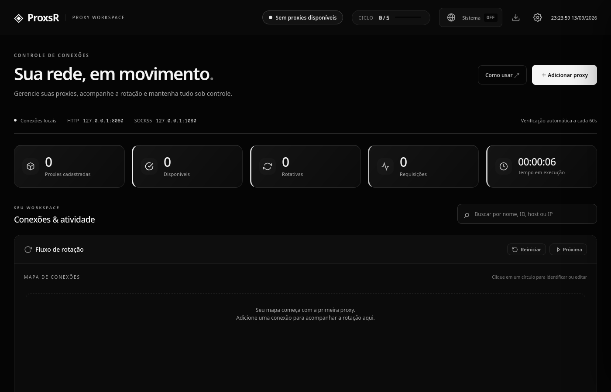
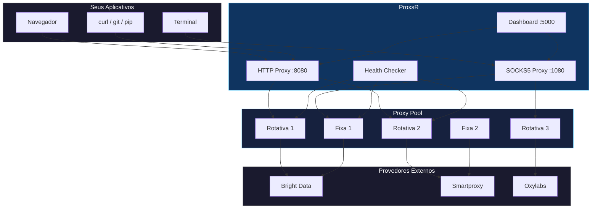
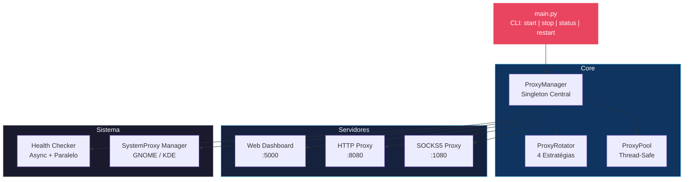
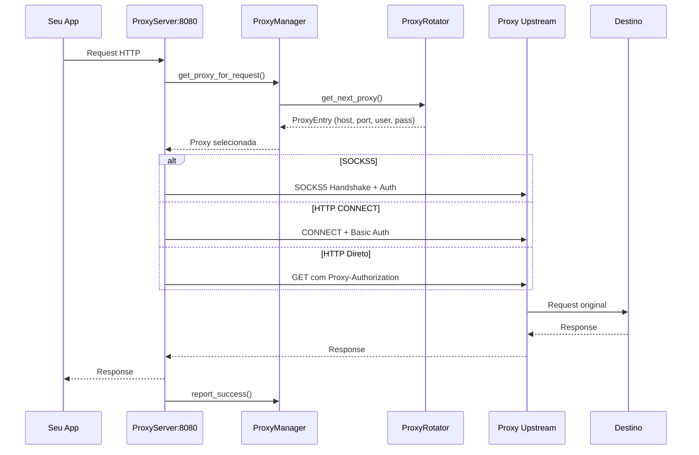
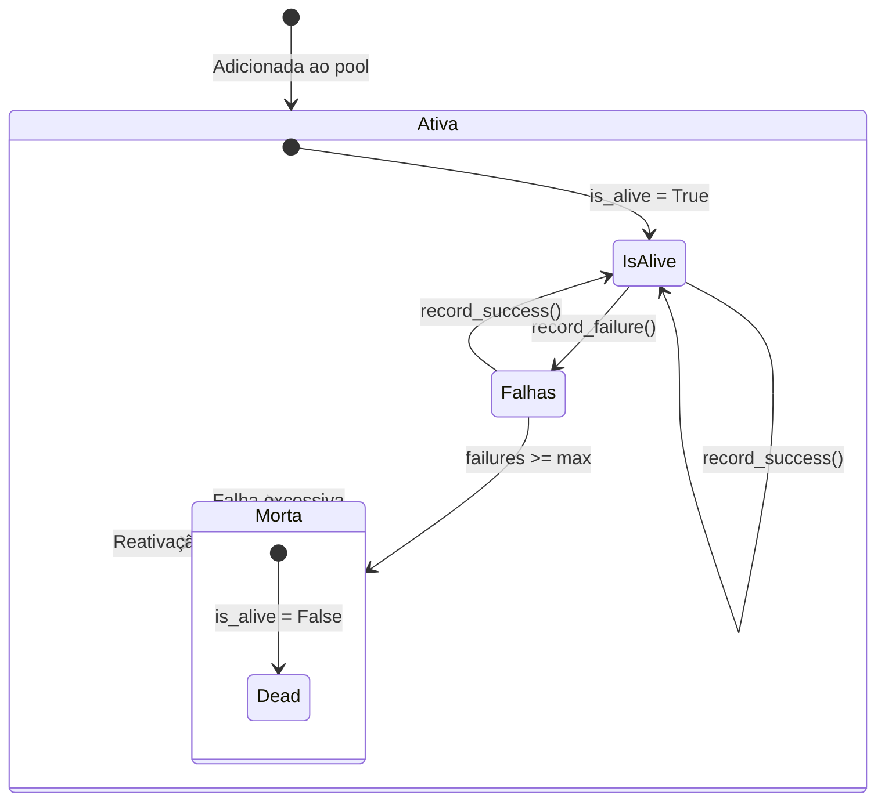
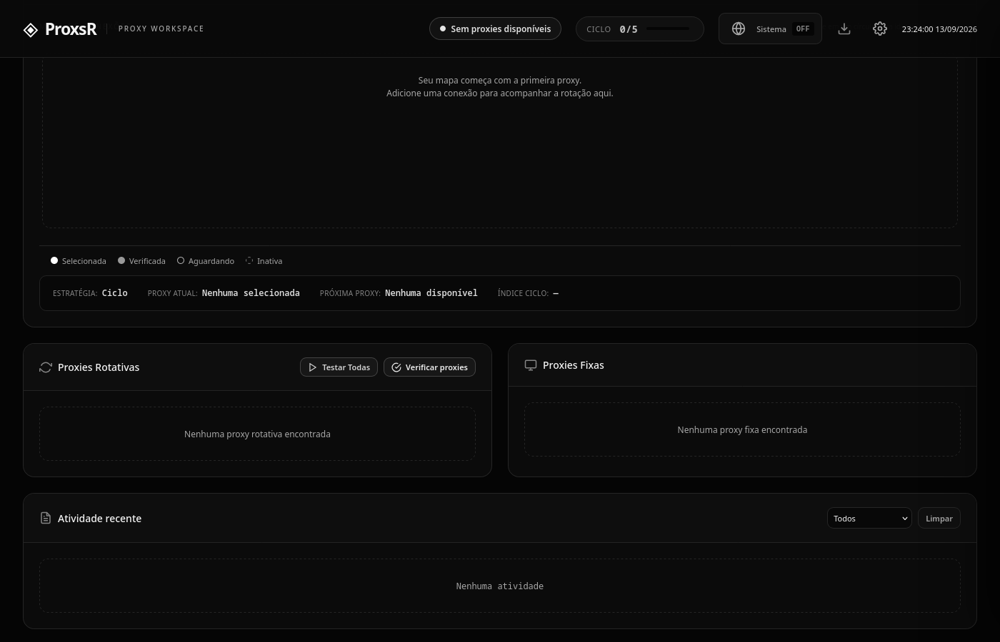
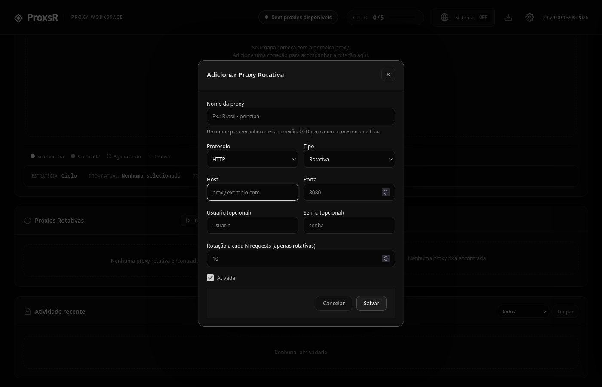
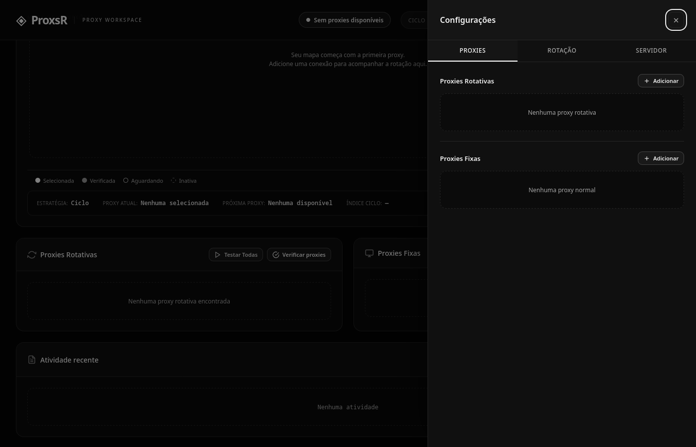
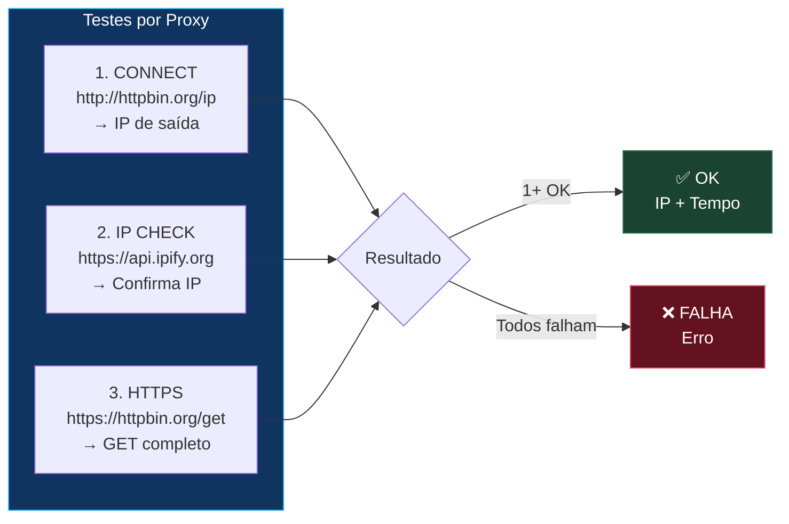
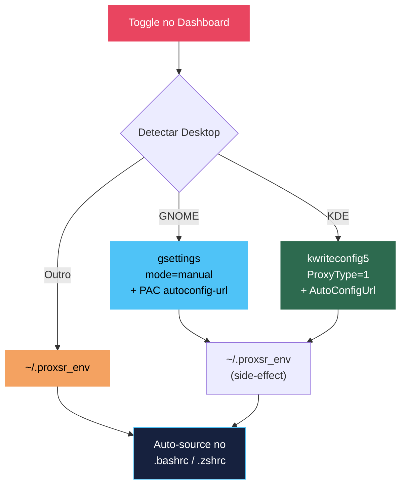

# ProxsR — Sistema Profissional de Rotação de Proxies

<p align="center">
  
</p>

<p align="center">
  <strong>Gerenciamento centralizado de proxies com rotação automática, health check, dashboard web e configuração do sistema Linux.</strong>
</p>

<p align="center">
  
  
  
  
</p>

---

## Sumário

- [Visão Geral](#visão-geral)
- [Funcionalidades](#funcionalidades)
- [Arquitetura](#arquitetura)
- [Instalação](#instalação)
- [Uso Rápido](#uso-rápido)
- [Dashboard Web](#dashboard-web)
- [Sistema de Teste de Proxies](#sistema-de-teste-de-proxies)
- [Proxy do Sistema](#proxy-do-sistema)
- [Configuração](#configuração)
- [CLI](#cli)
- [Estrutura do Projeto](#estrutura-do-projeto)
- [Roadmap](#roadmap)
- [License](#license)

---

## Visão Geral

O **ProxsR** é um sistema completo de rotação de proxies para Linux que permite:

- Rodar proxies **HTTP** e **SOCKS5** como servidores locais
- **Rotacionar** automaticamente entre múltiplos proxies de provedores
- **Testar** proxies com verificação de IP, velocidade e conectividade
- **Configurar** o proxy do sistema (GNOME/KDE) automaticamente
- **Monitorar** tudo em tempo real via dashboard web



---

## Funcionalidades

| Funcionalidade | Descrição |
|----------------|-----------|
| **Rotação de Proxies** | Estratégias: Ciclo, Sequencial, Aleatória, Menos Usada |
| **Proxy HTTP + SOCKS5** | Dois servidores locais rodando simultaneamente |
| **Health Check** | Verificação automática de proxies com timeout configurável |
| **Teste de Proxies** | Teste individual ou em lote com verificação de IP e velocidade |
| **Dashboard Web** | Interface completa com atualização em tempo real |
| **Proxy do Sistema** | Configura GNOME/KDE automaticamente via gsettings/kwriteconfig5 |
| **PAC File** | Gera arquivo de auto-configuração para navegadores |
| **Env Vars** | Auto-adiciona `source ~/.proxsr_env` ao .bashrc/.zshrc |
| **CLI Completo** | Controle total via terminal |
| **Persistência** | Configurações salvas em JSON, estado preservado |

---

## Arquitetura

### Diagrama de Componentes



### Fluxo de uma Request



### Ciclo de Vida de uma Proxy



---

## Instalação

### Pré-requisitos

- Python 3.10+
- Linux (GNOME ou KDE para proxy do sistema)

### Passo a passo

```bash
# Clone o repositório
git clone https://github.com/melinskyRf/proxsr.git
cd proxsr

# Crie um ambiente virtual
python -m venv venv
source venv/bin/activate

# Instale as dependências
pip install -r requirements.txt

# Configure suas proxies
# Edite config/proxies.json com suas proxies reais

# Execute
python main.py start
```

### Dependências

```
aiohttp
aiohttp-socks
```

---

## Uso Rápido

### 1. Adicione suas proxies

Edite `config/proxies.json`:

```json
{
  "rotating_proxies": [
    {
      "id": "br_1",
      "name": "Brasil · Principal",
      "type": "rotating",
      "protocol": "socks5",
      "host": "br.provedor.com",
      "port": 1080,
      "username": "seu_usuario",
      "password": "sua_senha",
      "rotation_count": 10,
      "enabled": true
    }
  ],
  "static_proxies": []
}
```

### 2. Inicie o sistema

```bash
python main.py start
```

### 3. Use o proxy

```bash
# Via HTTP proxy
curl -x http://127.0.0.1:8080 https://httpbin.org/ip

# Via SOCKS5 proxy
curl -x socks5://127.0.0.1:1080 https://httpbin.org/ip

# Ou configure o proxy do sistema no dashboard
```

### 4. Acesse o dashboard

Abra `http://127.0.0.1:5000` no navegador.

---

## Dashboard Web

### Visão Geral

<p align="center">
  
</p>

O dashboard mostra em tempo real:
- **Status do sistema** — se está online e quantas proxies estão ativas
- **Ciclo de rotação** — qual proxy está sendo usada e progresso
- **Proxy do sistema** — toggle para configurar GNOME/KDE
- **Estatísticas** — total de proxies, requests, erros

### Proxies Rotativas e Fixas

<p align="center">
  
</p>

Cada proxy card mostra:
- **Nome e ID** — identificação clara
- **Protocolo** — HTTP, HTTPS ou SOCKS5
- **Endereço** — host:port
- **IP de saída** — IP que o proxy usa (após teste)
- **Status** — Verificada / Não verificada / Indisponível / Desativada
- **Estatísticas** — requests e erros
- **Barra de progresso** — ciclo de rotação (rotativas)
- **Botões** — Testar, Ativar/Desativar, Editar, Excluir

### Modal de Adicionar Proxy

<p align="center">
  
</p>

Formulário completo com:
- Nome descritivo
- Protocolo (HTTP/HTTPS/SOCKS5)
- Tipo (Rotativa/Fixa)
- Host, Porta
- Usuário e Senha (opcional)
- Número de rotações

### Painel de Configuração

<p align="center">
  
</p>

Configure diretamente no dashboard:
- **Rotação** — estratégia, máximo de rotações, intervalo
- **Servidor** — portas HTTP, SOCKS5, Web
- **Logging** — nível de log, arquivo, tamanho

---

## Sistema de Teste de Proxies

### Como Funciona

O sistema de teste faz 3 verificações em cada proxy:



### Usando no Dashboard

1. Clique **"Testar Todas"** para testar todas as proxies
2. Ou clique **"Testar"** em cada proxy card
3. Veja os resultados no painel "Resultados dos Testes"
4. Badges aparecem nos cards com IP e tempo

### Usando a API

```bash
# Testar uma proxy
curl -X POST http://127.0.0.1:5000/api/proxy/test \
  -H "Content-Type: application/json" \
  -d '{"proxy_id": "br_1"}'

# Testar todas
curl -X POST http://127.0.0.1:5000/api/proxy/test-all \
  -H "Content-Type: application/json" \
  -d '{}'

# Ver resultados
curl http://127.0.0.1:5000/api/proxy/test-results
```

### Resposta da API

```json
{
  "ok": true,
  "result": {
    "id": "br_1",
    "protocol": "socks5",
    "host": "br.provedor.com",
    "port": 1080,
    "ok": true,
    "ip": "200.100.50.25",
    "response_time": 1.23,
    "tests": {
      "connect": {"ok": true, "time": 0.85, "ip": "200.100.50.25"},
      "ip_check": {"ok": true, "time": 1.10, "ip": "200.100.50.25"},
      "https": {"ok": true, "time": 1.23}
    }
  }
}
```

---

## Proxy do Sistema

### Como Funciona

Quando ativado no dashboard, o ProxsR configura o proxy do sistema operacional:

| Desktop | Método | Aplicativos Cobertos |
|---------|--------|---------------------|
| **GNOME** | `gsettings` + PAC autoconfig-url | GNOME Apps, Firefox (System Proxy) |
| **KDE Plasma** | `kwriteconfig5` + AutoConfigUrl | Qt/KDE Apps, Dolphin, Konsole |
| **Fallback** | `~/.proxsr_env` + auto-source | curl, wget, git, pip (terminais) |

### Fluxo de Ativação



### Auto-integração com Shell

Quando o fallback de env vars é usado, o ProxsR:
1. Cria `~/.proxsr_env` com todas as variáveis
2. Adiciona automaticamente `source ~/.proxsr_env` ao `~/.bashrc` e `~/.zshrc`
3. Ao desativar, remove o bloco dos arquivos de shell

---

## Configuração

### `config/config.json`

```json
{
  "server": {
    "http_host": "127.0.0.1",
    "http_port": 8080,
    "socks5_host": "127.0.0.1",
    "socks5_port": 1080,
    "web_port": 5000,
    "connect_timeout_seconds": 10,
    "request_timeout_seconds": 30,
    "idle_timeout_seconds": 60
  },
  "rotation": {
    "strategy": "cycle",
    "max_rotations": 10,
    "shuffle_on_restart": true
  },
  "health_check": {
    "enabled": true,
    "interval_seconds": 60,
    "timeout_seconds": 10
  },
  "proxy_defaults": {
    "timeout": 10,
    "max_retries": 3,
    "retry_delay": 1,
    "max_failures_before_dead": 3
  },
  "logging": {
    "level": "INFO",
    "file": "logs/proxsr.log",
    "max_bytes": 10485760,
    "backup_count": 5
  }
}
```

### Estratégias de Rotação

| Estratégia | Comportamento |
|------------|---------------|
| `cycle` | Usa cada proxy N vezes, depois embaralha e reinicia |
| `sequential` | Alterna a cada request: A→B→C→A→B→C |
| `random` | Seleciona aleatoriamente entre proxies vivas |
| `least_used` | Prioriza a proxy com menos requests |

### `config/proxies.json`

```json
{
  "rotating_proxies": [
    {
      "id": "br_1",
      "name": "Brasil",
      "type": "rotating",
      "protocol": "socks5",
      "host": "br.provedor.com",
      "port": 1080,
      "username": "user",
      "password": "pass",
      "rotation_count": 10,
      "enabled": true
    }
  ],
  "static_proxies": [
    {
      "id": "static_1",
      "name": "Backup",
      "type": "static",
      "protocol": "http",
      "host": "backup.provedor.com",
      "port": 3128,
      "username": null,
      "password": null,
      "rotation_count": 10,
      "enabled": true
    }
  ]
}
```

---

## CLI

```bash
# Iniciar o sistema
python main.py start

# Iniciar sem abrir navegador
python main.py start --no-browser

# Iniciar em porta personalizada
python main.py start --port 8888

# Ver status
python main.py status

# Parar
python main.py stop

# Reiniciar
python main.py restart
```

---

## Estrutura do Projeto

```
ProxsR/
├── main.py                  # Ponto de entrada CLI
├── requirements.txt         # Dependências Python
├── config/
│   ├── config.json          # Configurações do sistema
│   └── proxies.json         # Lista de proxies
├── src/
│   ├── __init__.py
│   ├── proxy_manager.py     # Gerenciador central (singleton)
│   ├── proxy_pool.py        # Pool thread-safe de proxies
│   ├── proxy_rotator.py     # Estratégias de rotação
│   ├── proxy_validator.py   # Validação async de proxies
│   ├── health_checker.py    # Verificação periódica de saúde
│   ├── server.py            # Servidores HTTP e SOCKS5
│   ├── web_server.py        # Servidor web + APIs
│   ├── system_proxy.py      # Configuração GNOME/KDE
│   ├── logger.py            # Sistema de log
│   └── utils.py             # Utilitários gerais
├── web/
│   ├── templates/
│   │   └── index.html       # Dashboard HTML
│   └── static/
│       ├── app.js           # JavaScript do dashboard
│       ├── style.css        # Estilos CSS
│       └── dark.css         # Tema escuro
├── logs/
│   └── proxsr.log           # Arquivo de log
└── docs/
    └── screenshots/         # Screenshots do dashboard
```

---

## APIs Disponíveis

| Método | Endpoint | Descrição |
|--------|----------|-----------|
| GET | `/api/status` | Status geral do sistema |
| GET | `/api/proxies` | Lista de todas as proxies |
| GET | `/api/rotator` | Estado do rotator |
| GET | `/api/activity` | Log de atividades |
| GET | `/api/health` | Status do health checker |
| GET | `/api/stats` | Estatísticas detalhadas |
| GET | `/api/config` | Configuração atual |
| POST | `/api/config` | Salvar configuração |
| POST | `/api/proxy/enable` | Ativar proxy |
| POST | `/api/proxy/disable` | Desativar proxy |
| POST | `/api/proxy/save` | Salvar/editar proxy |
| POST | `/api/proxy/delete` | Excluir proxy |
| POST | `/api/proxy/test` | Testar 1 proxy |
| POST | `/api/proxy/test-all` | Testar todas |
| GET | `/api/proxy/test-results` | Resultados de testes |
| POST | `/api/rotator/reset` | Resetar ciclo |
| POST | `/api/rotator/force-next` | Forçar próxima proxy |
| POST | `/api/health/run` | Executar health check |
| GET | `/api/system-proxy/status` | Status do proxy do sistema |
| POST | `/api/system-proxy/toggle` | Ativar/desativar proxy do sistema |
| GET | `/api/system-proxy/pac` | Baixar arquivo PAC |

---

## Roadmap

- [ ] Suporte a proxy **HTTPS** upstream (CONNECT com TLS)
- [ ] **Rate limiting** por proxy
- [ ] **Métricas Prometheus** exportáveis
- [ ] **Docker** support com docker-compose
- [ ] **Proxy chain** (encadear múltiplos proxies)
- [ ] **Geolocalização** de IPs no dashboard
- [ ] **Alertas** quando proxy cai (email/webhook)
- [ ] **API REST** completa para automação
- [ ] **Export/Import** de configurações
- [ ] **Temas** personalizáveis no dashboard

---

## License

MIT License - veja [LICENSE](LICENSE) para detalhes.

---

<p align="center">
  Feito com Python + aiohttp + asyncio
</p>
